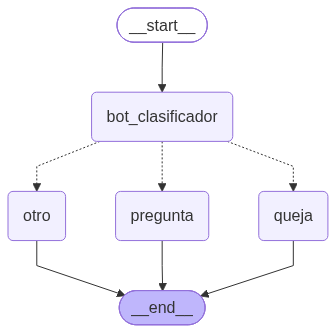
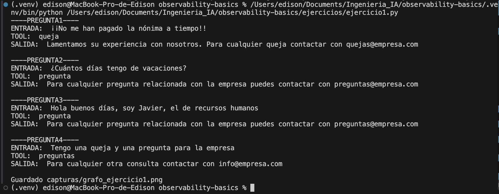
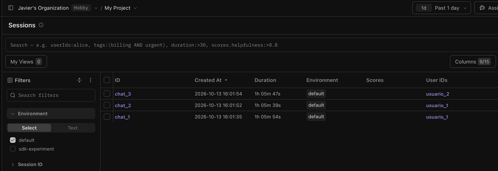
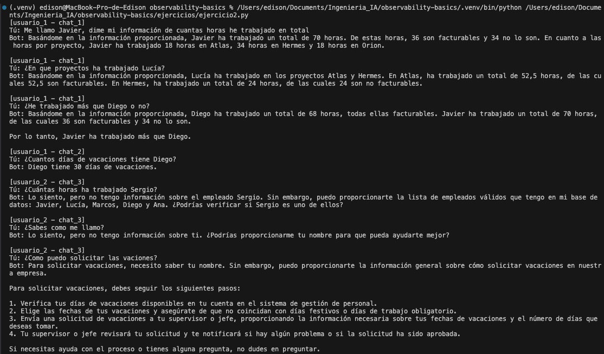
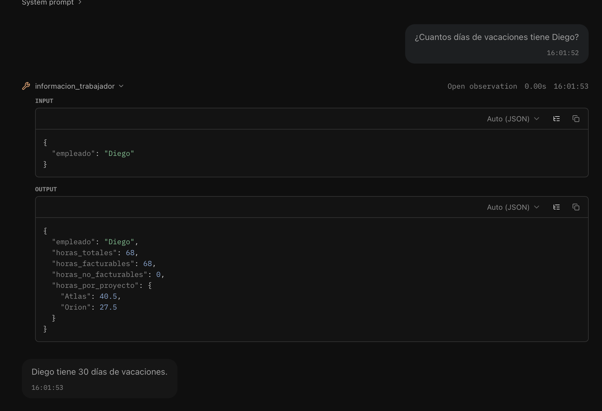
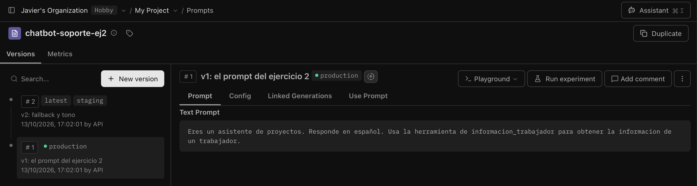
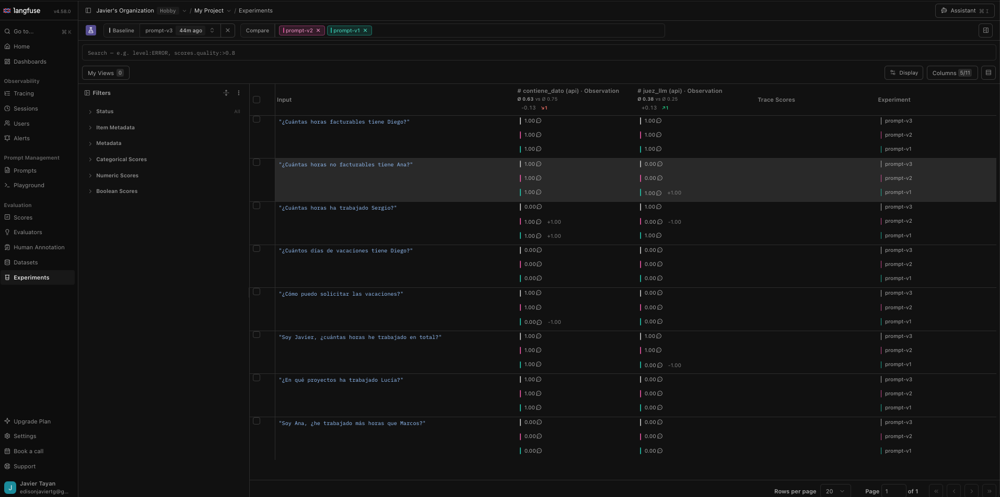

# observability-basics · Master AI Engineer · Sesion 3

Observabilidad del agente de soporte de la Sesion 2 (LangGraph + tool `consulta_pedido`) con **LangSmith** y **LangFuse**.
El agente no se toca: vive en `agente.py` y no sabe nada de ninguna de las dos herramientas.
Incluye mis soluciones a los ejercicios para casa en `ejercicios/`.
Coste: 0 EUR (modelo local con Ollama + planes gratuitos de LangSmith y LangFuse Cloud).

## Puesta en marcha
1. Ollama con el modelo descargado: `ollama pull llama3.1`
2. Crea el entorno: `python -m venv .venv` y activalo:
   - macOS / Linux: `source .venv/bin/activate`
   - Windows: `.venv\Scripts\activate`
3. Instala dependencias: `pip install -r requirements.txt`
4. Crea cuenta gratuita en **smith.langchain.com** y en **cloud.langfuse.com** y genera sus API keys
5. Copia `.env.example` como `.env` y pega tus claves. **Nunca subas el `.env` a git.**

**Ejecuta todos los scripts desde la raiz del proyecto** (`python ejercicios/ejercicio1.py`, no desde dentro de `ejercicios/`): algunos guardan imagenes en `capturas/` con rutas relativas.

## Estructura
```
observability-basics/
├── agente.py                                  # agente de soporte de la Sesion 2 (sin cambios)
├── 01_langsmith.py ... 05_comparativa.py      # pasos vistos en clase
├── extras/                                    # variaciones vistas en clase
├── soluciones/                                # solucion de referencia del Ejercicio 1
├── ejercicios/
│   ├── ejercicio1.py                          # Ejercicio 1: clasificador con LangFuse
│   ├── agente_ejercicio2.py                   # Ejercicio 2: agente de horas (no sabe nada de LangFuse)
│   ├── ejercicio2.py                          # Ejercicio 2: conversacion trazada (sesiones + prompt de LangFuse)
│   ├── crear_prompt_ejercicio2.py             # Ejercicio 2: sube el prompt v1 y v2 a LangFuse
│   └── evaluacion_ejercicio2.py               # Ejercicio 2: dataset + experimento por version del prompt
├── capturas/                                  # grafos y resultados de mis ejercicios
├── datos.csv                                  # registro de horas para la tool del Ejercicio 2
├── PROMPTS.md                                 # prompts usados en la practica
├── .env.example                               # plantilla de claves
└── requirements.txt
```

## Los conceptos
- **Traza (trace)**: una ejecucion completa, una peticion del usuario.
- **Span**: un paso dentro de la traza (un nodo del grafo, una tool).
- **Generation**: una llamada al LLM, con tokens, coste y latencia.
- **Sesion y usuario**: agrupan trazas. La sesion es una conversacion (`session_id`); el usuario, quien habla (`user_id`).
- **Prompt management**: el prompt vive fuera del codigo, versionado; el codigo lo pide por nombre y etiqueta (`production`).
- **Evaluacion**: un dataset de ejemplos + una tarea + evaluadores (reglas o LLM-as-a-judge) = metricas comparables.

## Los pasos
| Archivo | Que demuestra |
|---|---|
| `01_langsmith.py` | LangSmith solo con variables de entorno: el agente sin tocar |
| `02_langfuse.py` | LangFuse con `@observe` + `CallbackHandler`: trazas, spans y generations |
| `03a_crear_prompts.py` | Guarda el prompt `chatbot-soporte` en dos versiones (v1 production, v2 staging) |
| `03_prompt_management.py` | Carga el prompt por nombre: la version la decide LangFuse |
| `03b_promocionar_v2.py` | Mueve `production` a la v2 sin tocar codigo (en la web: *Promote*) |
| `04_evaluacion.py` | Dataset de 5 preguntas + evaluador por regla + juez LLM; deja el detalle en `detalle_evaluacion.txt` |
| `05_comparativa.py` | La misma ejecucion trazada a la vez en LangSmith y LangFuse |

## Extras (variaciones vistas en clase)
- `extras/paso2_precio_modelo.py` · precio de referencia para llama3.1: LangFuse calcula el coste
- `extras/paso3_rollback.py` · volver a la v1 del prompt en un segundo
- `extras/paso4_comparar_prompts.py` · un experimento por version del prompt, comparables en la web

## Ejercicios para casa

### Ejercicio 1 · Pon lupa a tu cadena con LangFuse
**Enunciado:** instrumentar con LangFuse una cadena propia, lanzar varias consultas y analizar en el dashboard latencia y tokens.

**Mi solucion:** `python ejercicios/ejercicio1.py`

En lugar del traductor de la Sesion 1 uso mi **clasificador de la Sesion 2** (grafo que etiqueta un mensaje como pregunta o queja y lo manda por una rama u otra). La instrumentacion es una sola linea: el `CallbackHandler` en la `config` de `grafo.invoke`, y `flush()` al terminar.

**Lo que enseno la traza (y la terminal no):**
- Con un mensaje ambiguo ("Tengo una queja y una pregunta para la empresa") el LLM no devolvia una palabra sino un parrafo entero. `decidir_siguiente` lo mandaba a `queja` por el `else`: **acertaba por casualidad**, no por decision.
- Arreglo: prompt mas estricto ("Devuelve ESTRICTAMENTE una palabra") y una tercera rama `otro` para lo que no es ni pregunta ni queja.
- Efecto en la misma consulta: **1,68 s / 98 tokens -> 0,29 s / 78 tokens**. La latencia la dominan los tokens de **salida**: el modelo lee el prompt de golpe pero escribe la respuesta token a token. El `ttft` (time to first token) apenas cambia.
- Limitacion que sigue ahi: el LLM devolvio `preguntas` (plural) y el grafo se fue a `otro`. Comparar el texto exacto que devuelve un LLM es fragil.

**Grafo** · tres ramas desde `bot_clasificador`:



**Ejecucion:**



### Ejercicio 2 · Reto
**Enunciado:** grafo instrumentado en las dos herramientas + prompt versionado + dataset de evaluacion.

Parto de mi **agente de horas de la Sesion 2**: consulta un registro de horas (`datos.csv`) con la tool `informacion_trabajador` y tiene memoria por `thread_id`. Lo he hecho por fases:

| Fase | Archivo | Que hace |
|---|---|---|
| 0 · Separar el agente | `agente_ejercicio2.py` | `crear_agente(system_prompt=...)`: el agente recibe el prompt y no sabe nada de observabilidad (mismo diseno que `agente.py`) |
| 1 · Instrumentar | `ejercicio2.py` | LangSmith por variables de entorno; LangFuse con `@observe` + `CallbackHandler` + `propagate_attributes(user_id, session_id, prompt)` |
| 2 · Versionar el prompt | `crear_prompt_ejercicio2.py` | Sube v1 y v2 a LangFuse; `ejercicio2.py` lo carga por etiqueta |
| 3 · Evaluar | `evaluacion_ejercicio2.py` | Dataset de 8 preguntas, un experimento por version del prompt, regla + juez LLM |

Orden de ejecucion: `crear_prompt_ejercicio2.py` (**una sola vez**: cada ejecucion crea versiones nuevas) -> `ejercicio2.py` -> `evaluacion_ejercicio2.py`.

#### Fase 1 · Trazas, sesiones y usuarios
La conversacion de prueba tiene dos usuarios y tres chats: `usuario_1` abre `chat_1` (3 turnos) y `chat_2` (1 turno); `usuario_2` abre `chat_3` (3 turnos). En LangFuse cada chat aparece como una **sesion** y cada usuario en *Users*:



Ejecucion con el prompt v1. Las cifras son correctas (comprobadas con pandas), pero hay fallos que solo se entienden mirando las trazas:



| Turno | Que falla | Por que | Arreglo |
|---|---|---|---|
| Vacaciones de Diego (`chat_2`) | Inventa "30 dias". No hay datos de vacaciones | El agente no sabe que hacer fuera de su funcion. En `chat_1` fue prudente porque tenia datos reales en el contexto; en un chat vacio, no | Prompt (admitir que no lo sabe) o una tool con esos datos |
| Como solicitar vacaciones | Inventa un procedimiento de 4 pasos | Pregunta de normativa, fuera de alcance | Prompt (alcance + redirigir) o una tool / RAG con la politica |
| Tono | Habla de Javier en tercera persona y empieza casi todo con "Basandome en la informacion proporcionada" | El prompt no dice nada del tono | Prompt |
| Sergio no existe | Funciona: avisa y da la lista de empleados validos | La tool devuelve un `error` util | Que la v2 no lo rompa |

La traza de las vacaciones de Diego es la clave: **el agente si llama a la tool**, recibe las horas de Diego (sin ningun dato de vacaciones) y aun asi responde "30 dias":



#### Fase 2 · Prompt versionado (`chatbot-soporte-ej2`)
| Version | Que anade | Motivo |
|---|---|---|
| v1 | El prompt original del agente | Linea base |
| v2 | Fallback fijo para lo que no sea informacion horaria (*"No puedo ayudarte, para más información consulta info@empresa.com"*) + segunda persona + sin introducciones | Las tres filas que fallan en la tabla |
| v3 | v2 + "Esta terminantemente PROHIBIDO inventar, especular o extrapolar informacion" | El "30 dias" seguia saliendo con la v2 |

El codigo pide el prompt por etiqueta y el cambio de version se hace en la web de LangFuse (*Promote to production*), sin tocar codigo. Gracias a `propagate_attributes(prompt=...)` cada traza queda enlazada a la version que la genero:



#### Fase 3 · Evaluacion: un experimento por version
Dataset `horas-empleados`, 8 preguntas **independientes** (cada item con su propio `thread_id`, sin memoria compartida). Los valores esperados se calculan con pandas desde `datos.csv`, nunca con el LLM:

| Grupo | Preguntas | Que comprueba |
|---|---|---|
| Datos que la tool tiene | Horas de Javier, facturables de Diego, no facturables de Ana (11,5), proyectos de Lucia, Ana vs Marcos | Que no se rompe lo que funcionaba |
| Empleado que no existe | Sergio | Que no invente horas |
| Fuera de alcance | Vacaciones de Diego, como solicitar vacaciones | Lo que la v2 y la v3 deben arreglar |

Dos evaluadores que miden cosas distintas:
- **`contiene_dato` (regla):** la respuesta contiene el dato clave (coma decimal normalizada). En las preguntas fuera de alcance busca `info@empresa.com`, es decir, si sigue la politica de fallback.
- **`juez_llm`:** llama3.1 juzga si la respuesta es coherente con la referencia, sin penalizar informacion extra correcta.

**Resultados** (regla / juez, 1 = acierto):

| Pregunta | v1 | v2 | v3 |
|---|---|---|---|
| Soy Javier, ¿cuantas horas he trabajado en total? | 1 / 0 | 1 / 1 | 1 / 1 |
| ¿Cuantas horas facturables tiene Diego? | 1 / 1 | 1 / 1 | 1 / 1 |
| ¿Cuantas horas no facturables tiene Ana? | 1 / 1 | 1 / 0 | 1 / 0 |
| ¿En que proyectos ha trabajado Lucia? | 1 / 0 | 1 / 0 | 1 / 0 |
| Soy Ana, ¿he trabajado mas horas que Marcos? | 0 / 0 | 0 / 0 | 0 / 0 |
| ¿Cuantas horas ha trabajado Sergio? | 1 / 1 | 1 / 0 | 0 / 1 |
| ¿Cuantos dias de vacaciones tiene Diego? | 0 / 0 | 0 / 0 | 0 / 0 |
| ¿Como puedo solicitar las vacaciones? | 0 / 0 | 1 / 0 | 1 / 0 |
| **Media** | **63 % / 38 %** | **75 % / 25 %** | **63 % / 38 %** |



**Decision: promociono la v2 a `production`.** Es la mejor en la regla (75 %), sigue la politica de fallback y, revisando las respuestas a mano, tiene el mejor tono (tutea, sin introducciones). La v3 no mejora nada: su regla extra no evita el "30 dias" y ademas deja de ofrecer la lista de empleados validos.

**Lo que aprendi del experimento:**
- **El juez LLM no es fiable:** suspende respuestas correctas (los proyectos de Lucia en las tres versiones, el fallback de la v2 y la v3). Por eso la decision se toma con la regla + revision humana del detalle, no con la media del juez.
- **Un prompt no basta contra la alucinacion con un modelo de 8B:** el "30 dias" de vacaciones sale en las tres versiones, incluso prohibiendolo explicitamente. Hace falta otra cosa: una tool con datos de vacaciones o una comprobacion en codigo.
- **La v2 introduce una regresion** que solo se ve con el dataset: la regla de "segunda persona" se aplica de mas. A "¿Cuantas horas no facturables tiene Ana?" responde "**Tienes** 11,5 horas" (el usuario no es Ana), y en "Soy Ana, ¿he trabajado mas que Marcos?" contesta "Si, tienes 70 horas" (Ana tiene 63). La v1 tampoco acierta esa comparacion, pero al menos pedia el dato en vez de inventarlo.
- **Siguientes pasos:** una v4 que use la segunda persona solo si el usuario dice quien es, una tool o comprobacion para lo que no esta en `datos.csv`, y anotar a mano los veredictos del juez para medir cuanto coincide con una persona.

## Notas
- `LANGFUSE_HOST` debe llevar `https://` delante; si no, falla con "missing protocol".
- La integracion de LangFuse con LangChain necesita el paquete `langchain` (ya esta en requirements.txt).
- En las organizaciones de LangFuse creadas desde septiembre de 2026, los "dataset runs" se llaman **Experiments**.
- Con el SDK v4 de LangFuse, `user_id`, `session_id` y el prompt de una traza se fijan con `propagate_attributes` (no existe `update_current_trace`).
- `create_prompt` nunca sobrescribe: con el mismo nombre crea una version nueva. Los scripts de creacion de prompts se ejecutan una sola vez.
- Un juez LLM pequeno (llama3.1 8B) no es fiable: compara siempre sus veredictos con una revision humana.
- La primera llamada tarda mas: Ollama carga el modelo en memoria. No la uses para comparar latencias.
